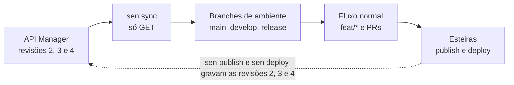

# Especificação do comando `sen sync`

> **Faseamento (2026-11-13):** a fase 1 (change `add-sen-sync`) implementa a carga e a verificação passando o id e a revisão, sem nenhuma consulta ao Git, e já inclui o contrato OpenAPI da seção "Futuro" (decisão de 16/11). A verificação de branch, o aviso de revisão inesperada, a recusa de carga já publicada no remoto, a `GitPort` e a identificação da branch na esteira ficam para a fase 2, em change próprio.

> **Pré-requisito (fora desta especificação): a API precisa estar na estrutura do APIOps antes do `sen sync`.**
>
> No Manager, a API deve ter quatro revisões, com os números 1, 2, 3 e 4, cada uma associada a um ambiente:
>
> | Revisão | Ambiente | Deploy |
> | --- | --- | --- |
> | 1 | Draft | Nunca tem deploy |
> | 2 | DEV | Deployada, se o deploy já aconteceu; senão fica sem deploy, mas já preparada |
> | 3 | HML | Deployada, se o deploy já aconteceu; senão fica sem deploy, mas já preparada |
> | 4 | PRD | Deployada, se o deploy já aconteceu; senão fica sem deploy, mas já preparada |
>
> **Observações:**
>
> - A API no Manager pode ter várias revisões sem deploy, mas com código útil. No APIOps, revisão sem deploy só é permitida no Draft (revisão 1), então esse conteúdo precisa ser consolidado (merge) nas quatro revisões antes de a API entrar no fluxo.
> - O produto prevê a exclusão de revisões, o que permite remover as revisões excedentes depois da consolidação.
>
> **Repositório da API:** o repositório já precisa existir, com a `main` contendo um commit inicial e ainda sem proteções. Esse commit traz o wrapper da esteira e o `api-basic-info.yaml` com o `spec.template` (id da API template) já preenchido na geração do repositório. A `develop` e a `release` são criadas a partir da `main` durante a carga (ver "Passo a passo da carga"). Criar o repositório faz parte do provisionamento de onboarding, e não do `sen sync`, que não altera o Git remoto.

## Contexto e objetivo

`sen sync` tem dois usos:

- **Carga:** traz uma API que já existe no API Manager para dentro do repositório Git da API, na estrutura de arquivos do APIOps. Cada branch de ambiente recebe o código da sua revisão. A partir daí o Git passa a ser a fonte da verdade, e o developer trabalha pelo fluxo normal (`feat/*` → PR → esteiras).
- **Verificação (reconciliação):** compara o repositório com o Manager e aponta onde estão diferentes. Não grava nada; serve para detectar quando o Manager e o Git deixaram de ser espelho um do outro.

Hoje isso é feito pelo script `extrair_estrutura.py` (repositório `apiops-extrator`), um protótipo só de leitura, configurado por constantes no código. Esta especificação define como esse comportamento entra no orquestrador como comando da CLI `sen`.

**Escopo:** carga inicial, uma vez por API, e verificação a qualquer momento, para APIs existentes no Manager. O contrato OpenAPI ainda não faz parte do repositório e fica para o futuro (ver "Futuro: contrato OpenAPI"). **Fora do escopo:** criação de API nova, escrita no Manager, commit ou push no Git remoto, e aplicar no Git as diferenças encontradas na verificação (ver "Decisões em aberto").

## Posição no fluxo

A carga roda só na entrada da API no APIOps, antes de as branches serem protegidas. Ela lê o Manager e grava os arquivos nas branches de ambiente; depois disso, toda mudança passa pelo fluxo de PRs e pelas esteiras, que são as únicas que escrevem no Manager. A verificação roda depois, quando for preciso confirmar que repositório e Manager continuam iguais.



O nome `sen sync` substitui o `sen version sync` citado no memory bank: é um comando só, com os dois usos.

| Uso | Quando | Como | Grava? |
| --- | --- | --- | --- |
| Carga | Entrada da API no APIOps | `sen sync` em `main`, `develop` e `release`, uma vez (ver "Passo a passo da carga") | Sim, só no disco local |
| Verificação | A qualquer momento depois da carga | `sen sync --check --revision <n>` em `main`, `develop` ou `release` | Não |

A verificação mantém o contrato que estava definido para o `sen version sync`: compara com a revisão canônica e não altera o Git remoto. A parte de "reconciliar" fica, por enquanto, em mostrar as diferenças; quem decide e aplica a correção é o time, pelo fluxo normal.

## Interface

O comando roda na raiz do repositório da API e recebe o id da API e o número da revisão que vai para a branch atual. Sem `--check`, faz a carga; com `--check`, faz a reconciliação e verificação.

```
sen sync --id <api-id> --revision <n> [--repo <pasta>] [--template <id>] [--check]
```

| Argumento ou opção | Padrão | Comportamento |
| --- | --- | --- |
| `--id` | obrigatório | Id da API no Manager. Se o `spec.id` do `api-basic-info.yaml` estiver preenchido, os dois precisam ser iguais |
| `--template` | o `spec.template` que já está no arquivo | Id da API template, gravado em `spec.template` depois de conferido no Manager (exit 3 se não existe ou não é visível). Só na carga (17/11) |
| `--revision <n>` | obrigatório | Número da revisão (`revisionNumber`, como aparece na interface do Manager), não o id interno. Na carga, é o código que vai para a branch atual; no `--check`, é a revisão comparada com a branch |
| `--check` | desligado | Verificação: compara o repositório com a revisão informada no Manager e mostra as diferenças, sem gravar nada (ver "Verificação") |

A revisão é escolhida por quem roda o comando. A correspondência esperada entre branch e revisão está em "Passo a passo da carga". Se a revisão informada não for a esperada para a branch atual, o comando avisa antes de gravar, mas segue.

As constantes que hoje ficam no topo do script (`HOST`, `TOKEN`, `API_ID`, `REVISION_NUMBER`, `DESTINO`) deixam de existir: o host e o token vêm do `.sen` e da sessão de login, o id vem do argumento ou do `spec.id`, e a revisão vem do `--revision`. `MAX_SLUG`, `MAX_ARQUIVO` e `MAX_SUFIXO_PASTA` viram constantes internas do módulo, não opções.

## Comportamento da carga

O comando só faz GET no Manager e só grava no disco local; nada é escrito até todas as leituras e checagens terem passado.

1. **Sessão.** Usa o token da sessão atual (`sen login` ou `sen login --service`). Sem sessão válida, falha com erro de autenticação.
2. **Destino.** Confere que o diretório atual é a raiz de um repositório Git e que a branch atual é `main`, `develop` ou `release`; em qualquer outra, recusa.
3. **Carga ainda não publicada.** Consulta o remoto: na `main`, o remoto pode ter só o commit inicial; na `develop` e na `release`, a branch ainda não pode existir no remoto. Se a carga já foi publicada, recusa e sugere `sen sync --check`: daí em diante as mudanças entram pelo fluxo de PRs.
4. **API.** `GET /apis/{id}`. Se o perfil developer não enxerga a API (regra de visibilidade do Manager), a resposta é o mesmo erro de "API não encontrada", sem revelar que ela existe.
5. **Revisão.** Procura o `revisionNumber` informado em `revisions` e faz `GET /revisions/{id}`. Se não existir, aborta indicando que a API não cumpre o pré-requisito das quatro revisões. Revisão sem recursos também aborta.
6. **Montagem em memória.** Gera todos os arquivos (ver "Estrutura gerada") sem tocar no disco. Os avisos de montagem são acumulados.
7. **Estrutura existente.** A área gerenciada (`api-basic-info.yaml`, `all.yaml`, `resources/`) é substituída por inteiro: na `main`, sobre o `api-basic-info.yaml` da geração do repositório; na `develop` e na `release`, sobre a estrutura que veio da `main`. O `spec.template` é mantido como está no arquivo, e o `spec.id` é gravado com o id da API. Arquivos fora da área gerenciada, como o wrapper, não são tocados. Se o `spec.id` existente for diferente do `<api-id>`, aborta.
8. **Escrita.** Grava num diretório temporário e move para o destino ao final. Se um caminho não puder ser escrito, nada é movido e o comando falha, em vez de deixar uma árvore parcial.
9. **Resumo.** Mostra os arquivos gerados, as contagens e os avisos, e lembra o próximo passo da carga (commit e a próxima branch, ou push e proteções).

## Passo a passo da carga

Cada branch de ambiente recebe o código da revisão correspondente, para que o espelho 1:1 entre branch e revisão valha desde o primeiro commit.

| Branch | Revisão | Ambiente |
| --- | --- | --- |
| `feat/*` | 1 | Draft |
| `develop` | 2 | DEV |
| `release` | 3 | HML |
| `main` | 4 | PRD |

As `feat/*` não recebem carga. Elas nascem da `main`, portanto com o código da revisão 4, e a revisão 1 (Draft) é a que o `sen validate` usa para diagnóstico, sobrescrita a cada validação.

A carga não pode ser feita pelo fluxo normal de PRs:

- A `main` só aceita PR vindo da `release`. Levar a revisão 4 para a `main` por PR exigiria colocar antes a revisão 4 na `release`, que deixaria de ter a 3.
- A `release` só aceita PR vindo de `feat/*`, com gates bloqueantes e aprovação humana, e o merge dispara a CI, que republica a revisão.

Por isso ela é feita uma única vez, como parte do onboarding, **antes de ativar as proteções das branches**. A ordem garante que todas as branches tenham a `main` como ancestral comum:

1. Na `main`: `sen sync --id <api-id> --revision 4` e commit.
2. Criar a `develop` a partir da `main`: `sen sync --revision 2` e commit. O commit contém só a diferença entre as revisões 2 e 4.
3. Criar a `release` a partir da `main`: `sen sync --revision 3` e commit. O commit contém só a diferença entre as revisões 3 e 4.
4. Fazer push das três branches.
5. Ativar as proteções das branches.

Se as branches fossem carregadas de forma independente, sem partir da `main`, não haveria histórico comum e todo merge de `feat/*` em `develop` ou `release` geraria conflito nos arquivos.

Mesmo com o ancestral comum, onde as revisões 2 ou 3 diferem da 4, o merge de uma `feat/*` (que parte da 4) em `develop` ou `release` pode gerar conflito nesses arquivos. Isso é esperado no modelo assimétrico e é resolvido no PR.

## Verificação

`sen sync --check` responde se o repositório e o Manager ainda são espelho um do outro. Não grava nada, nem no disco nem no Manager.

1. **Sessão, destino e API.** Iguais aos passos 1, 2 e 4 da carga: precisa de sessão, roda em `main`, `develop` ou `release`, e a revisão vem do `--revision`. O id da API vem do `spec.id`.
2. **Leitura do Manager.** Os mesmos GETs da carga (API e revisão), com as mesmas checagens.
3. **Comparação semântica.** O Conversor lê a árvore local para o modelo do Manager e compara com o modelo da revisão lida. A comparação é por conteúdo (recursos, operações, destinations, interceptors FIRST/SECOND e herança), não por texto: comentários, ordem de chaves e formatação do YAML não contam como diferença.
4. **Resultado.** Lista cada diferença com o arquivo e o campo, indicando o valor no repositório e no Manager. Se não há diferença, diz que estão iguais.

O resultado vem no exit code, para poder ser usado em automação: `0` quando estão iguais e `8` quando há diferença (ver tabela de erros).

**Diferença nem sempre é problema.** Há janelas normais em que o repositório está à frente do Manager: por exemplo, depois do merge e antes de a CI publicar, ou entre a publicação e o deploy aprovado em PRD. A verificação aponta a diferença; quem interpreta é o time.

**Corrigir uma diferença** continua sendo pelo fluxo normal: se o certo é o repositório, uma nova publicação pela esteira acerta o Manager; se o certo é o Manager (alguém alterou direto nele), a mudança é trazida para o Git numa `feat/*`, por PR.

## Estrutura gerada e regras de templatização

A árvore e as regras são as do script atual, que já seguem os itens V-01, V-12, V-16 e V-17 do refino e a D-003, sem a parte de contrato OpenAPI, que fica para o futuro. O orquestrador as reproduz sem mudar o formato. O mesmo formato vale para as três branches; muda só o conteúdo, que vem da revisão de cada uma.

```
<raiz do repo>/
├── api-basic-info.yaml       # kind ApiBasicInfo, campos em spec.<campo>
├── all.yaml                  # escopo all: destination + interceptors da raiz
└── resources/
    └── <slug-do-recurso>/
        ├── resource.yaml     # name, description, destination, herança
        └── <método>_<path>.yaml   # uma por operação
```

| Tema | Regra |
| --- | --- |
| Pasta do recurso | `slug(resource.name)`: NFKD para ASCII, sem `{}`, não alfanumérico vira `-`, minúsculas, corte em 60 caracteres no último `-`. Nomes reservados do Windows ganham `-recurso`. Colisão ou corte: sufixo legível pelo path da 1ª operação; se ainda colidir, sufixo com 6 caracteres do SHA-1 das operações |
| Arquivo da operação | `<método>_<path>.yaml`, com `/` virando `_` e `{param}` preservado (ex.: `get_letras_{id}.yaml`). Acima de 90 caracteres, corta e acrescenta 6 caracteres do SHA-1 de método e path |
| `api-basic-info.yaml` | `id`, `name`, `version`, `basePath`, `description`, `template`, `apiResponsible`, `apiTags`. `template` vem do arquivo gerado com o repositório e é mantido; `id` é gravado pelo `sen sync`; os demais vêm do Manager. Campos de fundo (visibilidade, datas, contadores) não entram: são hidratados no publish |
| `apiTags` | Ausente no Manager: não escrito (preserva o remoto). Lista vazia: `[]`, que significa remoção explícita |
| `destination` | Sempre declarado como `{ url, timeout }`; `url: ''` significa herdar do escopo acima |
| Interceptors | Só `executionPoint` FIRST (`interceptors_request`) e SECOND (`interceptors_response`). Os demais são estado não governado: contados num comentário e preservados no publish. `Custom` vira `{type, id}`; `content` JSON vira YAML |
| Herança | Lida dos marcadores do Manager, nunca por comparação de conteúdo. Item com `parent` e status `REMOVED` quebra a herança (`inherit: false`, arquivo declara o fluxo efetivo inteiro). Item sem `parent` soma ao herdado (`inherit: true`) |

## Autenticação, alcance e segurança

O `sen sync` usa o mesmo fluxo de autenticação dos outros comandos e aplica a regra de visibilidade do Manager antes de ler qualquer coisa.

- **Token.** Vem da sessão do Authenticator Module: login na API Orchestrator OAuth, validação em `AUTH_LOGIN_PATH + /validation` e uso do `admin_access_token` devolvido para as chamadas ao Manager. Nunca é passado como argumento nem gravado em arquivo do repositório.
- **Perfil developer.** Pode rodar a carga, mas só para APIs que já enxerga no Manager (organização, privada com ele listado, ou time dele). Fora disso, recebe o mesmo erro de API não encontrada.
- **Perfil esteira.** Enxerga tudo. Pode ser usado se o onboarding for automatizado no provisionamento do repositório.
- **Escrita.** Nenhuma chamada além de GET. O comando não escreve no Manager nem no Git remoto: commit e push da carga são feitos por quem conduz o onboarding.

**Ação imediata no script atual:** `extrair_estrutura.py` tem um access token de super admin em texto no código, e ele está no histórico Git do `apiops-extrator`. Mesmo que já tenha expirado, o token deve ser considerado exposto: revogar a credencial de origem, remover o valor do código e reescrever o histórico se o repositório for compartilhado.

## Pré-condições, erros e exit codes

Toda falha termina sem nada escrito no destino. Na verificação, o código `0` também significa "repositório e Manager iguais". Os códigos abaixo são uma proposta para o `sen sync`, a encaixar na padronização de exit codes que ainda está no backlog.

| Situação | Exit code | Mensagem orienta a |
| --- | --- | --- |
| Sucesso, com ou sem avisos (na verificação: sem diferença) | 0 | Commitar e seguir para a próxima branch, ou fazer push e ativar as proteções |
| Argumento ausente ou inválido (ex.: sem `<api-id>` na `main`) | 1 | Sintaxe correta do comando |
| Sem sessão, token expirado ou recusado (401/403) | 2 | Rodar `sen login` |
| API inexistente ou fora da visibilidade do usuário | 3 | Conferir o id e o acesso no Manager |
| Revisão informada inexistente na API | 4 | Usar um dos números listados, ou cumprir o pré-requisito das quatro revisões |
| Revisão sem recursos | 4 | Conferir a revisão no Manager |
| `spec.id` existente diferente do `<api-id>` | 5 | Conferir o id |
| Destino não é repositório Git, ou a branch não é `main`, `develop` nem `release` | 5 | Rodar na branch de ambiente certa |
| Carga já publicada no remoto (sem `--check`) | 5 | Usar o fluxo normal de `feat/*` e PR, ou `sen sync --check` para verificar |
| Caminho longo demais ou erro de escrita | 6 | Encurtar o caminho do clone (limite de 260 caracteres no Windows) |
| Erro de rede ou 5xx do Manager | 7 | Tentar de novo; nada foi escrito |
| `--check` encontrou diferença entre repositório e Manager | 8 | Analisar as diferenças listadas |

Duas mudanças de comportamento em relação ao script: hoje um caminho longo vira aviso e o arquivo é pulado, e a árvore fica parcial; e o script sai com `sys.exit` e mensagem, sem código por categoria.

## Saídas

A saída é um resumo no console. Não há relatório Markdown, porque o commit da carga já é o registro do que entrou.

O resumo traz:

- API (id, nome, basePath), branch e revisão lida (id interno e `revisionNumber`).
- Lista dos arquivos gerados, com contagem de arquivos, recursos e operações.
- Maior caminho relativo gerado, para antecipar problemas no Windows.
- Avisos deduplicados, cada um com a rota ou o recurso a que se refere.

Com `--check`, a saída é a lista de diferenças por arquivo e campo, com o valor no repositório e no Manager.

Avisos que o script já emite e que se mantêm nesta versão: recursos com o mesmo nome desambiguados, nome de arquivo truncado, `REMOVED` apontando para interceptor fora do fluxo herdado, status de herança não reconhecido e interceptor próprio idêntico a um herdado. Aviso nunca muda o exit code.

## Incorporação no orquestrador

O `sen sync` entra no orquestrador como um módulo novo, o **Sincronizador**, seguindo a arquitetura hexagonal. O módulo contém os dois casos de uso do comando (carga e verificação) e usa o Publicador para ler a plataforma, o Conversor para gerar os arquivos e duas portas próprias para disco e Git.

### Módulo Sincronizador

```
[adapter inbound]   cli_adapter.py ── subcomando `sync`
                           │
[Sincronizador]     SyncUseCase · CheckUseCase ──────────────┐
                      │          │           │               │
                      │      Conversor   diff_engine         │
                      │  (Manager↔arquivos)    (--check)
                      │                                      │
                  Publicador                    RepoLocalPort · GitPort
              (leitura da plataforma)           (portas do Sincronizador)
                      │                                      │
[adapters outbound] HTTP Sensedia             filesystem · git (só leitura)
```

| Peça | Onde fica | Novo ou existente | Responsabilidade no `sen sync` |
| --- | --- | --- | --- |
| Subcomando `sync` | Adapter inbound (`cli_adapter.py`) | Novo | Argumento, opção `--check`, exit codes e formato da saída |
| `SyncUseCase` | Sincronizador, camada de aplicação | Novo | Coordena a carga: valida branch e remoto, confere a revisão informada, lê, converte e escreve |
| `CheckUseCase` | Sincronizador, camada de aplicação | Novo | Coordena a verificação: escolhe a revisão, lê o Manager, lê a árvore local pelo Conversor e compara os modelos, sem escrever |
| `RepoLocalPort` | Sincronizador, porta de saída | Novo | Ler a árvore existente e gravar de forma atômica |
| `GitPort` | Sincronizador, porta de saída | Novo | Só leitura: se é repositório Git, branch atual e estado do remoto |
| Publicador | Módulo de interação com as APIs administrativas da Sensedia | Existente; ganha duas operações de leitura | Obter API e obter revisão |
| Conversor | Domínio | Existente; ganha o sentido Manager → arquivos | Regras de nome e herança, sem IO; no `--check`, também lê a árvore local para o modelo |
| `diff_engine` | Domínio | Existente, hoje vazio (02.01.04) | Diff semântico de modelos no `--check` |
| Adapter HTTP Sensedia | Adapter outbound | Existente | As chamadas HTTP de fato, com timeout e tratamento de 401/403/5xx |
| Adapter filesystem | Adapter outbound | Novo | Implementa o `RepoLocalPort` (diretório temporário + mover) |
| Adapter git | Adapter outbound | Novo | Implementa o `GitPort`, sem comandos de escrita |
| Authenticator Module | Módulo existente | Existente | Token usado pelo adapter HTTP |

Regras do módulo:

- **O Publicador não muda de conceito.** As leituras continuam sendo interação com as APIs administrativas. Toda a lógica do sync fica nos casos de uso do Sincronizador.
- **Só leitura na plataforma.** O Sincronizador depende apenas das operações de leitura do Publicador; nenhuma operação de escrita no Manager fica ao seu alcance.
- **Só leitura no Git.** O `GitPort` não expõe `add`, `commit`, `push` nem criação de branch, o que garante na arquitetura que o comando não altera o Git.
- **Caso de uso sem IO direto.** Disco, Git e plataforma entram por portas, então os casos de uso são testáveis com fakes (Manager simulado, disco em memória, Git simulado em cada branch para checar o aviso de revisão inesperada e as recusas).
- **Regras compartilhadas no Conversor.** Nome e herança precisam ser os mesmos na ida (`sen sync`) e na volta (`sen publish`), por isso ficam no Conversor e não no Sincronizador.

### Do script para o orquestrador

| Parte do script | Destino no orquestrador | Observação |
| --- | --- | --- |
| Constantes `HOST`, `TOKEN`, `API_ID`, `REVISION_NUMBER`, `DESTINO` | Subcomando `sync` em `cli_adapter.py` + `.sen` + Authenticator Module; a revisão vem do `--revision` | Some o token fixo no código |
| `http_get` | Leituras do Publicador sobre o adapter HTTP Sensedia | Timeout e tratamento de 401/403/5xx |
| `main` (resolução da revisão) | `SyncUseCase` | Passa a usar os exit codes da tabela |
| `slug`, `nome_pasta`, `slug_path`, `nome_arquivo`, `marca` | Conversor (`apiops_newstruct`) | Mesmo nome na ida e na volta; casa com a sub-task 02.03.04 (parser de operations) |
| `resolver_fluxo`, `bloco_heranca` | Conversor | O publish faz o caminho inverso: `inherit: false` vira marcadores `REMOVED` |
| `yaml_bloco`, `escalar`, `descricao` | Um serializador YAML único no Conversor | Um serializador só, preparado para receber o contrato no futuro |
| `gerar_basic_info`, `gerar` | Conversor, a partir dos modelos `Environment`, `Revision`, `Resource` | Depende da Story 02.03 (modelos do novo formato) |
| `escrever` | `RepoLocalPort` + adapter filesystem | Escrita atômica; muda o comportamento de árvore parcial |

No backlog, a Story 06.03 (`sen version sync`) dá lugar a uma story própria do `sen sync`, dependente da 02.02 (autenticação) e da 02.03 (modelos). O `diff_engine` da sub-task 02.01.04 é o que produz o diff do `--check`.

## Critérios de aceite

O comando está pronto quando faz a carga das três branches pela CLI, com a mesma árvore que o script gera hoje (sem a parte de contrato), e essa árvore volta ao Manager sem diferença.

- [ ] Para a mesma API e revisão, `sen sync` produz arquivos idênticos byte a byte aos do `extrair_estrutura.py`, desconsiderando a parte de contrato OpenAPI, (teste de referência com APIs reais de exemplo).
- [ ] Ida e volta: a árvore gerada, lida pelo conversor, reconstrói a revisão sem diferença em recursos, operações, destinations, interceptors FIRST/SECOND e herança.
- [ ] Seguindo o passo a passo, `main`, `develop` e `release` terminam com o código das revisões 4, 2 e 3, com a `main` como ancestral comum.
- [ ] A revisão gravada é a do `--revision`; se ela não for a esperada para a branch, o comando avisa.
- [ ] Em qualquer branch que não seja `main`, `develop` ou `release`, o comando recusa.
- [ ] Depois que a carga foi publicada no remoto, o comando recusa.
- [ ] Rodar duas vezes na mesma branch, antes do push, não gera nenhuma mudança no `git diff`.
- [ ] Usuário developer não consegue carregar API fora da sua visibilidade, e a mensagem não revela que ela existe.
- [ ] Nenhuma falha deixa arquivo escrito no destino.
- [ ] Revisão inexistente e revisão sem recursos abortam com o exit code da tabela.
- [ ] Nenhum token aparece em argumento, log ou arquivo gerado.
- [ ] Logo depois da carga, `sen sync --check` com a revisão de cada branch retorna `0`, sem diferenças.
- [ ] Uma alteração feita direto no Manager aparece no `--check`, com arquivo, campo e os dois valores, e retorna `8`.
- [ ] Mudar só comentários ou formatação do YAML no repositório não gera diferença no `--check`.
- [ ] O `--check` não grava nada em nenhuma situação.
- [ ] O `spec.template` preenchido na geração do repositório continua igual depois da carga.
- [ ] A estrutura gerada passa no `sen validate`.

## Decisões em aberto

Quatro pontos precisam de decisão; a proposta desta spec vem entre parênteses.

1. **Aplicar as diferenças da verificação.** Hoje o `--check` só mostra. Trazer automaticamente para o Git o que mudou no Manager faria o Manager sobrescrever a fonte da verdade, e depende de saber se a edição direta no Manager é bloqueada. (Proposta: manter só a verificação nesta versão; a correção segue pelo fluxo normal.)
2. **Verificação na esteira.** O `--check` pode rodar na CI para detectar edição direta no Manager. Rodar antes do `sen publish` mexeria na decisão de que o publish não faz sync prévio. (Proposta: não acoplar ao publish; se for usado, como job separado e informativo.)
3. **Mapeamento branch × revisão.** O aviso de revisão inesperada usa o mapeamento atual de três ambientes. Se a P1 aprovar um quarto ambiente (sandbox), o mapeamento muda. (Proposta: manter o mapeamento em configuração, não fixo no código.)
4. **Exit codes.** Os códigos 1 a 8 desta spec precisam entrar na padronização geral de exit codes da CLI, que ainda está no backlog.

## Futuro: contrato OpenAPI

O repositório da API ainda não guarda o contrato OpenAPI, então o `sen sync` não o traz nesta versão. Quando o contrato entrar na estrutura do repositório, o script atual já tem o comportamento pronto para ser incorporado:

- Leitura do swagger da mesma revisão (`GET /revisions/{id}/swagger`), aceitando só OpenAPI 3; Swagger 2.0 aborta pedindo migração no Manager.
- `components.yaml` com as seis seções de components (`schemas`, `securitySchemes`, `responses`, `requestBodies`, `headers`, `examples`).
- No `api-basic-info.yaml`, `info.contact`, `tags` e `security` da raiz do swagger.
- Em cada arquivo de operação, `summary`, `operationId`, `tags`, `security`, `parameters`, `requestBody` e `responses`, com parâmetros do path mesclados, `$ref` de parâmetro expandido e chaves `x-*` removidas.
- Avisos de contrato: `$ref` inexistente, parâmetro que não é objeto, rota fora do swagger e rota sem `responses`.
- No `--check`, o contrato passa a fazer parte da comparação.

No orquestrador, isso entra no Conversor (funções `contrato_operacoes`, `contrato_raiz`, `sem_extensoes`, `expandir_parametro` e `gerar_components` do script), e o Publicador ganha a leitura do swagger. No backlog, corresponde à sub-task 02.01.03 (`sen sync openapi`).

## Referências cruzadas

- [Comandos CLI (`sen`)](comandos-cli-sen.md)
- [Autenticação e segurança da CLI](autenticacao-e-seguranca-da-cli.md)
- [Fluxo de desenvolvimento](fluxo-de-desenvolvimento.md)
- [Estratégia de branches](estrategia-de-branches.md)
- [Backlog de desenvolvimento do orquestrador](../delivery/backlog-orquestrador.md)